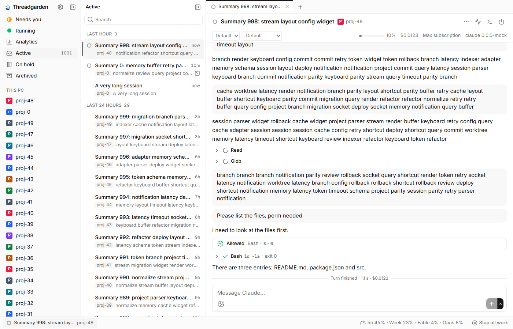
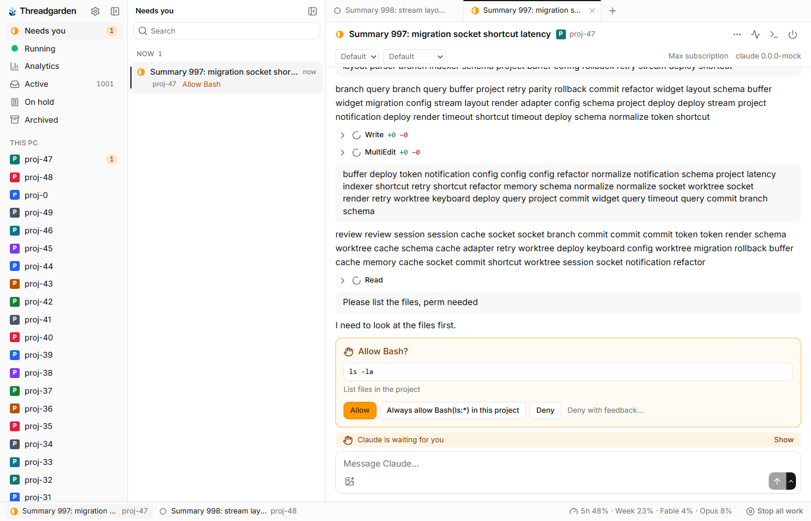
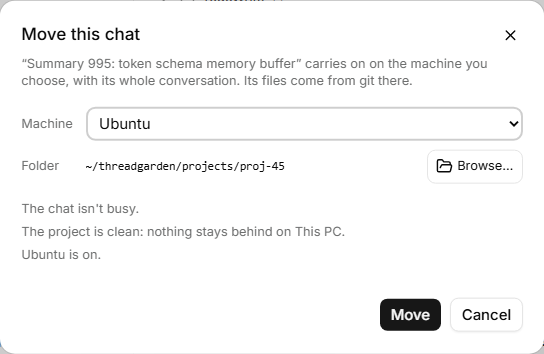
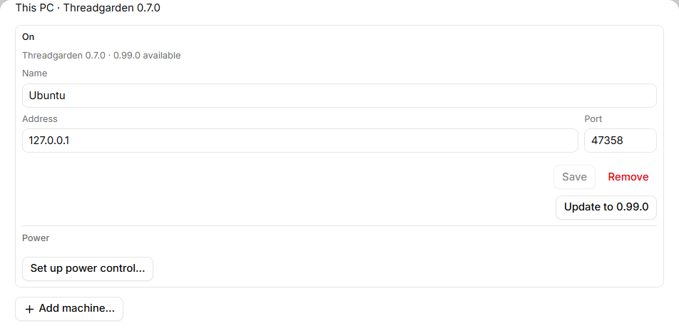
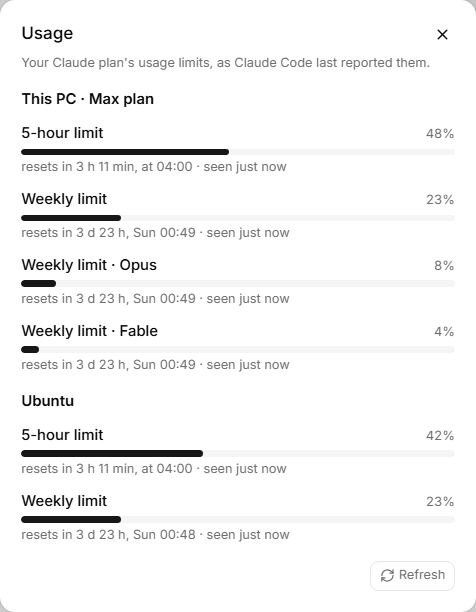

<p align="center">
  
</p>

<h1 align="center">Threadgarden</h1>

<p align="center">A desktop app for your <a href="https://code.claude.com/docs">Claude Code</a> chats.</p>

See every Claude Code conversation you've had, run new ones in tabs, and know when an agent is waiting on you. Close the window and your agents keep going. It can also run them on another PC.

It uses your own `claude` install and login, through the official Agent SDK. Not affiliated with Anthropic. Still early, so expect rough edges.

<p align="center">
  
</p>

<details>
<summary><b>More screenshots</b> (made-up data; the chat text is nonsense on purpose)</summary>









</details>

## Features

- **History:** every chat, by project, searchable; file them as Active, On hold or Archived. Chats started in a terminal show up too.
- **Live chats in tabs:** code, diffs, todos and subagents rendered properly; permission prompts answered in the chat.
- **Needs you and Running** across all projects, with a tray badge and notifications.
- **Activity panel:** see and stop subagents and background processes.
- **Usage meter** per Claude account, and "send when the limit resets".
- **Remote machines:** run chats on another computer from the same window. Start a project, clone a repo, or move a chat there with its whole conversation, and update it from Settings.
- **Power:** turn a remote machine on and off through a Tasmota smart plug.
- **Away machines:** read an off machine's chats from a local copy; a reply waits and goes out once it's on.
- Analytics, a quick switcher (Ctrl+K), keyboard shortcuts (Ctrl+/ lists them) and themes.

## Install

Get the [latest release](https://github.com/JiriPlasek/ThreadGarden/releases/latest): `-setup.exe` or `.msi` on Windows, `.dmg` on macOS (Apple silicon), `.AppImage`, `.deb` or `.rpm` on Linux (needs WebKitGTK 4.1).

You need Claude Code installed and signed in, or an Anthropic API key set in Settings. The builds aren't code-signed yet, so SmartScreen and Gatekeeper will warn the first time. After that the app updates itself, with signed updates; `.deb` and `.rpm` installs get a link to the new version instead.

To build it yourself, see [CONTRIBUTING.md](CONTRIBUTING.md).

## Connect an Ubuntu machine

The other PC needs Ubuntu 22.04 or newer on x64, on your home network. Replace the `<placeholders>`. The [full guide](docs/remote-machines.md) has explanations and troubleshooting, plus [power control](docs/remote-machines.md#4-power-control) and reaching it from outside home with a VPN.

**1. SSH.** At the Ubuntu PC:

```sh
sudo apt update && sudo apt install -y openssh-server curl
sudo systemctl enable --now ssh
hostname -I
```

From your own computer, connect with `ssh <user>@<address>`. Everything below runs in that session.

**2. Stay reachable.** Reserve the PC's address in your router. Skip the two `nmcli` lines on a cable or on Ubuntu Server, and the `ufw` line unless `sudo ufw status` says active.

```sh
nmcli -f NAME,TYPE connection show
sudo nmcli connection modify "<wifi-name>" connection.permissions "" connection.autoconnect yes
sudo nmcli connection modify "<wifi-name>" 802-11-wireless-security.psk-flags 0 802-11-wireless-security.psk "<wifi-password>"
history -c
sudo systemctl mask sleep.target suspend.target hibernate.target hybrid-sleep.target
sudo ufw allow 47380/tcp
```

**3. Claude Code.** It prints a sign-in link: open it on your own computer and paste the code back.

```sh
curl -fsSL https://claude.ai/install.sh | bash
source ~/.profile
claude
```

**4. git and GitHub**, needed for Clone and for creating repos. Choose "Login with a web browser".

```sh
sudo apt install -y git gh
git config --global user.name "<your name>"
git config --global user.email "<you@example.com>"
gh auth login --insecure-storage
gh auth setup-git
```

**5. Threadgarden.** Run this as your own user, not with sudo. The installer asks for your password to let the service start at boot and power the machine off.

```sh
rm -rf ~/threadgarden-download && mkdir ~/threadgarden-download && cd ~/threadgarden-download
base=https://github.com/JiriPlasek/ThreadGarden/releases/latest/download
curl -fLO "$base/threadgarden-headless-linux-x64.tar.gz"
curl -fLO "$base/threadgarden-headless-linux-x64.tar.gz.sha256"
sha256sum -c threadgarden-headless-linux-x64.tar.gz.sha256
tar -xzf threadgarden-headless-linux-x64.tar.gz
cd threadgarden-headless-*/
./install.sh
threadgarden status
```

**6. Pair.** Run `threadgarden pair` for a one-time code. Then in Threadgarden, go to Settings → Machines → **Add machine…** and enter the PC's address and the code. To start, click **New chat** and choose the machine.

**Updating:** from 0.8.0 on, use **Update to ‹version›** in Settings → Machines. It rolls back by itself if the new version doesn't start. Older machines repeat step 5.

**Or a Windows PC (through WSL).** On Windows 11 22H2 or newer, signed in as the Windows user who'll own the worker, open PowerShell with **Run as administrator**. The script sets up WSL, a `threadgarden` distro, networking and a start-at-boot task; the check must print `True`.

```powershell
mkdir ~\threadgarden-setup -Force | Out-Null; cd ~\threadgarden-setup
$base = 'https://github.com/JiriPlasek/ThreadGarden/releases/latest/download'
curl.exe -fL -O "$base/threadgarden-setup-worker.ps1" -O "$base/threadgarden-setup-worker.ps1.sha256"
(Get-FileHash .\threadgarden-setup-worker.ps1).Hash -eq (Get-Content .\threadgarden-setup-worker.ps1.sha256).Split(' ')[0]
Unblock-File .\threadgarden-setup-worker.ps1
powershell -ExecutionPolicy Bypass -File .\threadgarden-setup-worker.ps1
```

Then open the distro with `wsl -d threadgarden`, run `cd ~`, and do steps 3 to 6 above inside it. The [guide](docs/remote-machines.md#a-windows-pc-as-the-worker-wsl) explains what the script changes, power control and removal.

## Your data

Threadgarden never writes to `~/.claude`; the only things there are Claude Code's own transcripts of your chats. A chat moved to another machine is kept in Threadgarden's data on that machine.

Its data, including the text of your chats, lives in `%APPDATA%\threadgarden`, `~/Library/Application Support/threadgarden` or `~/.local/share/threadgarden`. Delete the folder to start fresh. API keys and pairing tokens go to your OS keychain.

The app only talks to localhost, your paired machines, GitHub (for updates) and your power switch, if you use one. `claude` talks to Anthropic as usual.

## Login and terms

There's no Threadgarden account; it uses whatever Claude Code uses. Anthropic's Agent SDK docs say third-party products shouldn't offer claude.ai login unless approved, and point to API keys instead. Whether your setup is fine is between you and Anthropic's terms, so give them a read (this isn't legal advice). For an API-key-only build, set `THREADGARDEN_API_KEY_ONLY=1`. More in [docs/architecture.md](docs/architecture.md#authentication).

## Known limitations

- Tabs only: no split view or embedded terminal.
- No `bypassPermissions`, and terminal-only commands like `/config` or `/login` don't work.
- Chats running in another terminal are shown, not driven.
- After Claude Code compacts a chat, history starts at the compaction.
- Clicking a notification brings the window forward, but doesn't open the chat.
- A moved chat isn't listed by `claude --resume` on its new machine, and can't be forked yet.
- A machine that's off shows only the last few messages of each chat.
- macOS and Linux pass CI but haven't seen much real use.

## License

Not yet chosen: all rights reserved until a license is added.
