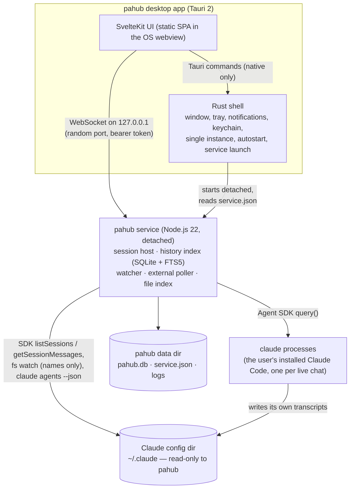

# pahub architecture

How pahub v1 is built, as it stands. The original design is in
[`docs/superpowers/specs/2026-10-30-pahub-v1-design.md`](superpowers/specs/2026-10-30-pahub-v1-design.md)
(section numbers like §4.2 below refer to it); where the build differs from
it, [Deviations from the v1 design](#deviations-from-the-v1-design) says how
and why. Package-level detail is in each package's README.

## Processes

pahub is three kinds of process:

- **The app** is a Tauri 2 shell (Rust) hosting a SvelteKit 5 static UI. Rust
  handles only native concerns: the window and tray, notifications, the OS
  credential store, single instance, start on login, reading dropped images,
  and finding or launching the service. The UI talks to the service directly
  over a WebSocket, so streamed output takes one hop.
- **The service** (`packages/service`) is a long-lived TypeScript process on
  Node.js 22. It owns every Claude Code session pahub runs, the history
  index, external-session polling and the `@` file index, and stores its own
  state in `pahub.db` (`node:sqlite`, no native addons). It is TypeScript
  because the Agent SDK, the only official programmatic interface to Claude
  Code, exists for TypeScript and Python only. Release builds run it as one
  esbuild bundle (`service.mjs`) on a Node.js runtime shipped as the Tauri
  sidecar `pahub-node`.
- **Claude Code processes**: each live chat is one Agent SDK `query()` in
  streaming-input mode, which spawns the user's installed `claude`
  (`pathToClaudeCodeExecutable`; no fallback to the SDK's bundled binary) with
  the user's own configuration (`settingSources: ["user","project","local"]`,
  the `claude_code` system prompt preset, `cwd` = the project). They write
  their transcripts to the Claude config dir exactly as in a terminal. A new
  chat's generated title (v1.2) briefly starts one more `claude` process, which
  writes no transcript (see Chat titles under [Data flows](#data-flows)).

The service is a separate, detached process so that closing or crashing the
window never stops a running agent.

## Lifecycle

**Starting the app.** The shell reads `service.json` from the data dir,
checks that its pid is alive and that `hello` answers on the advertised port,
and otherwise starts the service detached (Windows: a new process group with
no console, breaking away from the app's job object when allowed; Unix: a new
session via `setsid`; stdio to the null device) and waits up to 15 s for a
live `service.json` whose service answers. The service takes a lock file in
the data dir, so only one runs per data dir; it listens and writes
`service.json` first and looks for Claude Code (`claude --version`, which can
take seconds) in the background, so the UI can connect at once — requests
that need Claude Code (`system.status`, starting or resuming a chat, resume
checks) wait for that answer. A recorded service that is alive but slow to
answer is not a failure: the extra service started meanwhile exits on the
lock, and the recorded one is used once it answers. If no service answers in
time, the window shows the error with **Retry**. The UI then connects with
the token from `service.json`.

**Crash safety.** The service logs an unhandled rejection or uncaught
exception and keeps running (one stray error must not end every agent); only
a burst of more than 10 uncaught exceptions in a minute ends the process.
Shutdown runs every step even if one fails, and always releases the lock.

**Versions.** `hello` exchanges the protocol version and the service version.
A different protocol version is incompatible: the UI shows a blocking screen
that offers to restart the service. The same protocol with a different
service version (an app update while the old service still runs) shows a thin
"older version" bar instead; pahub never restarts the service on its own,
because that would end running agents. **Restart service** confirms (listing
the running agents), sends `service.shutdown {stopAll: true}`, waits for the
old process to exit and starts the app's version.

**Window and tray.** Closing the window hides it; the app stays in the tray
to post notifications. A second launch focuses the existing window. The tray
offers "Open pahub", "Stop all work…", "Quit pahub (keep agents running)" and
"Quit pahub completely…" (confirms, stops all work, shuts the service down,
exits). Quitting the app alone leaves the service and its agents running; the
next launch reconnects to them.

**Service.** With no live session and no connected client for 30 minutes the
service exits. When it stops for any other reason (crash, reboot, shutdown
with live chats), the chats that were live are recorded in `pahub.db`, and the
next start shows them as interrupted, ready to resume. The conversation itself
is safe: Claude Code persisted it.

**Live chats** (§4.3). A chat becomes live when a message is sent in it (new
chat or continuing a history chat, with SDK `resume` and the same session id).
**End session** closes the process and returns the chat to history. A live
chat that is idle (no turn running, nothing waiting on the user) for 15 minutes
(setting; 0 disables) is reclaimed: its process is closed, it shows as
paused, and the next message resumes it transparently. Pinned chats, chats
waiting on the user and chats with a running background task (Ruling R29:
closing the process would kill it) are never reclaimed. Closing a tab never
ends a session.
**Stop** (or Esc) interrupts only the current turn: pahub declares the SDK's
`perTaskStopAffordance` (it renders a Stop per task, wired to `stop_task`), so
the CLI spares running background agents and processes, which are stopped one
at a time from the Activity panel. Without the declaration the CLI would kill
them on every interrupt. End session ends them with the process.
**Stop all work** interrupts and closes every live pahub session; the service
keeps running.

**Activity panel** (v1.1 §2, v1.3 §2). Each live session folds the SDK's
`system/task_*` and `background_tasks_changed` messages into a task list
(`chat/tasks.ts`), published as `chat.tasks`. An agent's model is on no task
frame: the tracker takes it from the `model` input of the Agent call that
started the task, else from the `message.model` of the subagent's streamed
messages (`parent_tool_use_id`), remembered per tool use id because they
arrive around the task frames in either order. The prompt, spawn depth and
workflow name come from `task_started`. The UI orders each section (not
ended first, then by end time), nests tasks under their `parentTaskId` and
shows the panel on every chat while the one global `activity.open` setting
is on; a narrow chat pane opens it as a drawer on request instead.

## Protocol

`packages/protocol` types every message with zod schemas shared by the
service and the UI; the service validates every request.

- **Transport:** one WebSocket per UI on `127.0.0.1`. The token is offered as
  the WebSocket subprotocol `pahub.<token>` and compared in constant time; a
  connection without it is closed (code 4401).
- **Requests** `{id, method, params}` → `{id, result}` or `{id, error: {code,
  message}}`. Error codes the UI acts on include `GAP`, `RESUME_BLOCKED`,
  `CLAUDE_MISSING`, `NOT_LIVE`, `NOT_FOUND`, `FORK_FAILED` and
  `INVALID_PARAMS`. Methods cover places and lists (`places.counts`,
  `sessions.list`, `projects.*`, `search.quick`), chats (`chat.open`,
  `chat.older`, `chat.since`, `chat.create`, `chat.send`, `chat.respond`,
  `chat.fork`, `chat.end`, model/mode/effort controls, `chat.resumeCheck`),
  pahub-side metadata, drafts, UI state, settings, `files.suggest`,
  `work.stopAll`, `service.shutdown` and `system.status`. `chat.markSeen`
  records that the user has seen a chat's latest turn ("Your turn", below).
- **Events** `{event, data}` are pushed to every client: `chat.items` and
  `chat.status` per chat, plus list-level events (`sessions.changed`,
  `projects.changed`, `external.changed`, `index.progress`). `needsYou` and
  `chatFinished` (a pahub chat ended a turn) tell the UI when to notify.
- **Sequencing and resync.** Every `chat.items` / `chat.status` event carries
  a per-chat sequence number, and each chat keeps its last 5,000 events. A
  reconnecting UI asks `chat.since {seq}` for everything after the last seq it
  saw and buffers live events until the answer is applied, so nothing is
  missed or duplicated. When the events are no longer available the service
  answers `GAP` and the UI reloads the chat with `chat.open`. Each service
  start numbers events in a new epoch (`epoch × 2³²`, the epoch persisted and
  advanced at every start), so a seq from a previous service process can never
  match and always gives `GAP`.
- **Streaming** is coalesced: a chat emits at most one `chat.items` event per
  33 ms, and items are upserted by id (a streamed text item keeps its id while
  it grows; a tool result updates its call).

## Data flows

**History comes only from the Agent SDK.** pahub never opens a transcript
file. The indexer calls `listSessions()` for metadata (title, summary, first
prompt, cwd, branch, `lastModified`, `fileSize`) and, for sessions that are
new or whose `lastModified`/`fileSize` changed since they were indexed,
`getSessionMessages()`. Opening a chat reads it with `getSessionMessages()` and
maps every SDK message to protocol `ChatItem`s (`src/chat/normalize.ts`), the
same mapping live sessions use. Unknown message types and content blocks
become `unknown` items carrying the raw JSON, so a newer Claude Code degrades
to a generic rendering instead of breaking.

**Watcher.** The service watches `<config>/projects` recursively for
file-system events and maps event names of the form
`<project>/<session-id>.jsonl` to session ids (debounced 500 ms); it never
opens or reads the files, and if the directory does not exist yet it retries.
Changed ids go to the indexer's incremental refresh.

**Indexer and full-text search.** Index state lives in `pahub.db`: one row per
session (metadata, the `lastModified`/`fileSize` it was indexed at, its
project) and an FTS5 trigram table of user and assistant text. Tool calls,
tool results and thinking are not indexed. A session's text is capped at 2 Mi
characters, keeping the most recent text. Re-indexing a session pages through
its messages (yielding to the event loop between pages), writes the new text
as a staged *generation* of FTS rows, and makes it current with one short
statement; old generations are deleted afterwards. A failure part-way leaves
the previous text searchable, and the event loop never blocks on a large
session. A full sync runs at every start in the background; the UI shows
progress in Settings and works meanwhile.

**Projects.** A project is a working directory that has sessions, grouped by
real path; git worktrees are grouped under their repository (from `git`
metadata, read-only). Display names are directory basenames, disambiguated by
their parent when two collide. The list is ordered pinned first, then by most
recent activity, where activity includes what pahub's live chats are doing
right now: a project rises as soon as a chat in it is active, and
`projects.changed` (at most once a second) tells clients when live activity
changed the order. Each project says whether its folder still `exists`
(a `stat`, cached per folder, refreshed at most every 60 s and after a sync);
the UI groups the missing ones under Missing folders (with "Hide all missing",
which hides each through `projects.update`). At most two checks run
at once and one per volume, so a hung network share delays only its own
folders.

**Catalog and paging.** Lists combine three sources: index rows, pahub's own
live chats (status, what they wait for) and external sessions. The live and
external rows (the *overlay*) are small and change constantly, so they are
returned in full on the first page of any place; later pages are index rows
only, keyset-paged and excluding overlay ids, so the cursor never drifts when
a chat changes status. Hidden projects stay visible in Needs you and Running
(an agent waiting for you is never hidden) but are left out of Active (v1.2;
formerly All chats) and the other bucket places.
Running lists the working chats and (Ruling R29) every live pahub chat with a
running background task (an agent or process, not paused or finished), even
while its turn is idle: an idle chat whose dev server still runs is listed
there with its status still idle and its `runningTasks` count, and it counts
in `places.counts.running` and its project's running count. The session host
reports each change of that count, and the service sends `sessions.changed`
for the chat so lists refresh.
Titles follow pahub custom title → generated title (v1.2) → Claude Code's own
title → summary → provisional title (v1.2) → first prompt. The summary is
skipped when it equals the first prompt or the chat has a provisional title
(without a title of its own, the SDK's summary is just the latest prompt). All
but a custom title are cut to 80 characters.

**Your turn.** When a pahub chat's turn ends (a `result` that leaves it
waiting for the user, not one followed by queued input, and not one of a turn
the user stopped from pahub with Stop or Esc), the service stores
the time in `pahub.db` (`turn_state`, pahub's own table) and emits
`chatFinished`. A chat is `unread` while its last turn ended after it was last
seen (`chat.markSeen`, also implied by `chat.send` and `chat.create`) and it is
neither waiting on the user nor working. Needs you lists the waiting chats
first, then the unread ones by most recent turn end, and its count includes
both. The two times are ordered by operation as well as by clock, so a turn
end and a seen mark in the same millisecond still compare correctly.
The UI decides what "seen" means: a chat is marked seen while it is the active
tab of a focused window (at once on `chatFinished`, otherwise after the tab
has been shown for a moment, so tabs only passed through stay unread), and it
posts the "finished — your turn" notification only for chats not on screen.

**Buckets** (v1.2). Every chat is Active, On hold or Archived, stored in
pahub's own `chat_buckets` table. `sessions.list` takes the places `active`,
`onHold` and `archived` (`all` is an alias of `active`), and a project place
lists its active chats unless `include` adds the others; Needs you and Running
span every bucket. `chat.setBucket` moves chats in bulk and refuses, per chat,
to archive one pahub runs (`LIVE`: the UI asks "End this chat and archive
it?", ends it and retries) or one running elsewhere (`RUNNING`); the UI
reports the chats it skipped. Archiving marks chats seen (Ruling R32). A hold
whose time runs out (checked at startup and every 60 s) returns the chat to
Active as `backFromHold`: listed under Needs you, announced with
`chatBackFromHold`, and cleared by `chat.markSeen` (which the UI sends when the
chat is viewed, as for unread chats) or a message. Bucket and project lists
keep it at its recency position, like an unread history chat (Ruling R34), so
the UI's Now section (which counts "Your turn" only for live and external
chats) does not claim it. A hold that ends while its chat works or waits on
the user is not flagged until the chat is idle, and so is not announced then;
the UI announces it at its next connect. The UI announces holds that end
together in one notification, and, once per hold, the ones that ended while no
window was connected (it keeps the announced ids in `uiState`, and forgets an
id when its chat is put on hold again). An archived chat returns to Active
when it is sent a message, or when it runs as an external session, which
pahub notices only while external-session polling is on (and `claude agents`
is available). Sending a message to a chat on hold ends the hold too (Ruling
R36). `chat.archiveOlder` archives a place's idle, seen, unpinned chats older
than N days (with `dryRun` for the confirmation's count; Ruling R35). Quick
search ranks archived matches after all others and flags them, keeping up to
3 places for them (at most half the results), and the UI lists them in their
own group.

**Chat titles** (v1.2). Claude Code titles only its terminal sessions, so a
chat pahub starts gets a provisional title at once: the first sentence of the
first line of its first message (also set when pahub continues a chat that
has no title of any kind). After the chat's first turn, if "Name new chats
automatically" (`autoTitles`, on by default) is on, the service asks a small
model for a 3–6 word title, at most once per chat, at most two at a time and
with a 20 s timeout. The request is one Agent SDK `query()` with a string
prompt, which starts one more `claude` process: model `haiku`, a naming system
prompt, the first message and the start of the first reply (2,000 characters
in all), `persistSession: false` (`--no-session-persistence`: no transcript),
`settingSources: []`, no tools (`tools: []`, `strictMcpConfig`), one turn and
no thinking, with the same `claude`, environment and authentication as the
user's chats. Because it loads no settings, it is skipped (Ruling R33) when
the user, project or local settings set `env`, `apiKeyHelper`,
`awsAuthRefresh`, `awsCredentialExport`, `gcpAuthRefresh` or
`otelHeadersHelper`, or cannot be parsed, so it never goes around the
provider the user chose. The answer is cleaned (its first line, without
quotes, labels or end punctuation; more than 10 words is no title) and stored
in pahub's own `chat_titles` table, next to the provisional title; any failure
keeps the provisional title and is logged at debug level, without content. A
generated title is cleared when Claude Code's own title of the chat changes
later (a rename in the terminal). While the query's process runs it is listed
by `claude agents`: the poller counts its session id as pahub's own while it
runs and for 15 s after it ends, so it never shows as an external chat.

**Chat view.** `chat.open` returns the last N items of the SDK history merged
with the live session's items (the live version wins for anything both have),
plus the current seq. The normalized history of a chat is cached (bounded at
about 32 Mi characters across chats) while the chat's indexed size and mtime
are unchanged, or for the life of the session object while pahub holds the
chat. Older items page in with `chat.older`.

**External sessions and resume safety** (§4.4, §6.3). The poller runs
`claude agents --json --all` every 2 s while the window is visible and every
10 s while it is hidden, parses it leniently, and drops pahub's own sessions
(by session id). If the command is missing or fails, the feature hides itself
and says why in settings. Before pahub continues any chat it does not hold
live, `chat.send` runs the command again (fresh, not the last poll):

- **blocked** when the session is listed with a live pid or as working or
  blocked: the UI explains why and offers the hand-off commands
  (`claude --resume <id>`, `claude attach <short id>`);
- **ok** when it is listed only as finished without a pid, or not listed;
- **unverified** when the command cannot be run: the UI asks the user to
  confirm, and also warns when the transcript was modified in the last 2
  minutes (from the indexed `lastModified`, never a file stat).

**`@` mentions.** `files.suggest` lists a project's files with
`git ls-files --cached --others --exclude-standard` in a git repo, or a
`.gitignore`-aware walk elsewhere, cached for 30 s per project, and ranks them
with fuzzysort. Mentions are sent as plain `@path` text and expanded by Claude
Code exactly as in the terminal (verified below).

**Settings** are one row per key in `pahub.db`, read back over the
schema defaults (`Db.getSettings`). Each stored value is checked on its own:
an invalid or corrupt one reads as its default and never resets the others,
and the v1.3 appearance fields read an unknown value (a newer accent) as
their default. Patches (`settings.set`) are validated strictly.

**Appearance (v1.3).** The UI applies the theme as `data-theme` on `<html>`
and the appearance settings next to it: `data-accent` (graphite, the
pre-v1.3 neutral look and the default, or blue, teal, green, violet, rose,
amber), `data-light-style` (default, warm), `data-dark-style` (default, dim,
midnight) and `data-ui-font` (inter, system); a custom code font becomes
`--font-mono` on `<html>`, its names reduced to letters, digits, spaces and
`_-.` (`sanitizeFontFamily`, in the protocol) and quoted. The token
overrides are in `apps/desktop/src/routes/themes.css`; the defaults have
none, so the default look is the stylesheet as it was. The UI keeps a copy of
these settings in `localStorage`: `app.html` applies it before the first
paint, and the service's settings replace it once connected. A unit test
cascades the real stylesheets for every theme, style and accent and checks
WCAG AA (4.5:1) for text pairs and the primary button; the one shortfall is
the unchanged default light look's muted text on the muted grey (4.34:1).

**Fork** calls the SDK's `forkSession(id, {upToMessageId})`, which writes a new
session file next to the original and leaves the original untouched; the
fork is indexed at once so it can be opened.

## Security model

- **Loopback and token.** The service binds `127.0.0.1` only, on a random port.
  The token is 32 random bytes (hex), regenerated at every service start, and
  stored only in `service.json`, written atomically with mode `0600` in the
  user's data dir. Every connection must present it.
- **Content Security Policy:** `default-src 'self'`; `connect-src` only the
  Tauri IPC origins and `ws://127.0.0.1:*`; `img-src 'self' data: blob:`, so
  remote images in model output are never fetched (no tracking pixels);
  `style-src 'self' 'unsafe-inline'` (Svelte and the UI components set inline
  styles; model output never carries `style` attributes, see the sanitizer
  below); no objects, no forms, `base-uri 'self'`.
- **Markdown sanitizer.** Model output is rendered with `marked` and sanitized
  by a dedicated DOMPurify instance with an allow-list of plain document
  markup: no scripts, styles, forms, iframes, event handlers or `style`/`class`
  attributes from the model. Code blocks are highlighted (shiki, lazy-loaded)
  from text and pass a second, separate allow-list.
- **Navigation guard** (`navigation.rs`). The webview may only show the app's
  own origin (and the dev server under `tauri dev`); any other top-level
  navigation is refused.
- **Links** open in the system browser through the opener plugin, whose
  capability allows only `http://` and `https://` URLs.
- **Dropped files.** The webview receives dropped files only as paths. Image
  bytes are read by one Rust command that accepts only paths from the most
  recent drop, only PNG, JPEG, GIF and WebP, and only up to 5 MB, checked
  before reading. Other dropped files become `@` mentions, never read by pahub.
- **API key.** Kept in the OS credential store through the `keyring` crate
  (Windows Credential Manager, macOS Keychain, Secret Service), sent to the
  service after each `hello`, and held there in memory only, never stored or
  logged.
- **Title requests** (v1.2). With "Name new chats automatically" on, the
  first message of each chat pahub starts and the start of its first reply
  (2,000 characters at most) are sent once more, to Claude Code's `haiku`,
  through the user's own `claude` and authentication, with no tools, no
  settings and no transcript; never when settings route requests elsewhere
  (Ruling R33).
- **Permissions.** pahub offers the default, acceptEdits, plan and auto
  permission modes, never `bypassPermissions`, and it filters out "always
  allow" suggestions that would switch a session to bypass.
- **Capabilities.** The window gets only the Tauri permissions it uses: core
  defaults, notifications, the open-folder dialog, clipboard write, autostart
  and URL opening.

## Performance

The budgets in §8 are requirements. The techniques that meet them:

- Lists and search come from SQLite (WAL); the SDK is asked only about
  sessions that changed.
- Indexing runs in the background, incrementally, and yields between pages.
- Chat lists and message views are virtualised (fixed-height rows and
  section headers in the chat list; measured rows in the message view).
- Streaming is coalesced to one update per 33 ms; markdown rendering is cached
  per item.
- The quick switcher keeps a prepared fuzzysort corpus of titles and projects,
  and drops stale answers.
- Dialog overlays have no backdrop blur: re-blurring the window behind the
  Ctrl+K dialog cost tens of milliseconds per keystroke on software-rendered
  webviews.

Automated tests enforce the budgets: `pnpm test:perf` for the service, over a
synthetic corpus of 1,000 sessions in 50 projects with one 2,000-message
session, and `pnpm test:e2e` for the UI in Chromium against the mock service.
CI runs them with `PAHUB_PERF_SLACK=3`. Measured on the development machine
(Windows 11) with slack 1:

| What | Budget | Measured |
| --- | --- | --- |
| Full-text search over 1,000 sessions | 150 ms | max 15.7 ms |
| Quick switcher query (service side) | 50 ms | max 10.4 ms |
| `@` suggestions over 200k files | 50 ms | max 17.3 ms |
| Event-loop delay while building a 200k-file index | 50 ms | max 15.0 ms |
| Event-loop delay while indexing a 20 MB session | 50 ms | max 9.2 ms (221 ms total) |
| Service idle memory after indexing 1,000 sessions | 150 MB | 101.6 MB RSS |
| Switching to an open tab | 50 ms | median 9.5 ms |
| Opening a history chat | 150 ms | median 22.0 ms |
| Ctrl+K, per keystroke (UI, end to end) | 50 ms | max 22.5 ms |
| Composer keystroke | 16 ms | median 1.3 ms, p90 2.2 ms |

UI timings run from the input event to the DOM showing the result plus a
forced layout. Against a real history of about 500 sessions, the bundled
service settled at about 70 MB after its first full index. The first full
index reads each transcript once through the SDK (`getSessionMessages`
parses the whole file on every call, so paging it, as the first versions did,
was quadratic in transcript length). Re-measured on 2026-10-30 against the
same real history (512 sessions; the indexer alone, run in-process into a
temporary data dir, `~/.claude` only read): 77 s with one read per session
(512 SDK reads), against 108 s for the paged version (718 SDK reads). The
peak memory stayed about the same (558 MB vs 552 MB): it is set by the SDK
holding the largest transcript fully parsed, which one read per session
cannot avoid. pahub's own chats are not re-indexed while a turn streams; they
are indexed once the turn ends. App launch times (§8: 800 ms warm, 2 s cold) are not
measured automatically; the release checklist covers them by hand.

## Authentication

By default pahub never handles credentials: each session's `claude` process
inherits the environment of the pahub service, so it authenticates exactly as
the user's installed Claude Code does (subscription login or an API key in
the environment). If the user sets an API key in pahub's settings,
`buildSessionEnv` (`packages/service/src/sdk/real-adapter.ts`) copies the
service environment and adds `ANTHROPIC_API_KEY` for every session pahub
starts. The SDK's `env` option replaces the child environment, so the copy
keeps `PATH`, `HOME`, proxies and everything else.

### Verified behaviour (spec §5.5)

Checked on 2026-10-30 with Claude Code 2.1.314 and
`@anthropic-ai/claude-agent-sdk` 0.3.314 on Windows 11, signed in with a
subscription, using the opt-in real test
(`pnpm --filter @pahub/service test:real`, `test/real/smoke.real.test.ts`).

| Session environment | `accountInfo()` | `system/init` `apiKeySource` |
| --- | --- | --- |
| No `ANTHROPIC_API_KEY` | `apiProvider: "firstParty"`, `subscriptionType` set (the plan name), `email` set, no `apiKeySource`, no `tokenSource` | `"none"` |
| `ANTHROPIC_API_KEY` set (dummy value) | `apiProvider: "firstParty"`, `apiKeySource: "ANTHROPIC_API_KEY"`, `tokenSource: "claude.ai"`, no `subscriptionType`, no `email` | not observed (no turn was run) |

What this shows:

- Without a key, sessions run on the stored subscription login.
- With `ANTHROPIC_API_KEY` in the session environment, an SDK-mode session
  reports the key as its credential (`apiKeySource: "ANTHROPIC_API_KEY"`) and
  no longer reports the subscription, even though the stored login is still
  present (`tokenSource: "claude.ai"`). No approval prompt for the key
  appears in SDK mode.

What was **not** verified: that requests are actually billed to the key.
No real key was available, and with the dummy key no prompt was sent, to
avoid a failing API call. The check stopped at `accountInfo()`, which needs
only the session's initialize handshake. Verify this with a real key before
relying on API billing (send one short prompt with a real key and check the
key's usage in the Anthropic Console).

So the status bar's authentication label can come from `accountInfo()`:
`apiKeySource` present means an API key; otherwise `subscriptionType` and
`apiProvider` identify the login or a third-party provider.

### Other facts from the same run

- The `sessionId` pahub passes to the SDK for a new chat is the
  `session_id` in `system/init`, so the chat id is known before the CLI
  answers.
- A user text message sent through streaming input is **not** echoed back as
  a `user` SDK message, so the user item that `LiveSession` adds locally
  appears exactly once.
- A startup failure arrives as a `result` (`error_during_execution`) with
  `startup_failure_reason` and the CLI's message in `errors`. After it, the
  SDK's message iterator throws. pahub sets
  `CLAUDE_CODE_STARTUP_FAILURE_RESULTS=1` so the CLI writes that result for
  every known cause. Checked with `proxy_invalid` (an unparsable
  `HTTPS_PROXY`), which fails before any API call.
- Running the service from inside a Claude Code terminal (inherited
  `CLAUDECODE`, `CLAUDE_CODE_SESSION_ID`, …) did not change the session id
  or the authentication.

## Finding `claude`

`packages/service/src/sdk/claude-path.ts` hands the SDK the user's installed
`claude` as `pathToClaudeCodeExecutable`; there is no fallback to the SDK's
bundled binary. SDK 0.3.314 runs a path ending in `.js`/`.mjs`/`.ts`/`.tsx`/`.jsx`
with `node` (or `bun`) and spawns anything else directly with
`child_process.spawn` and no shell. On Windows that means a `.cmd` or `.bat`
launcher (what `npm install -g` creates) cannot be started. So discovery
prefers `claude.exe` everywhere. A `claude.cmd` is used only after resolving
it to the program it starts (npm's `cli.js` or a native `.exe`). If that
program cannot be determined, cannot be spawned or is missing, discovery
reports `unrunnable` with an explanation.

## Verified against the real Claude Code

`pnpm --filter @pahub/service test:real` (`test/real/service.real.test.ts`)
runs the whole service over the WebSocket against the installed `claude`, the
user's login and their real history, in a throwaway git repo with a temp data
dir. Last run on 2026-10-30 with Claude Code 2.1.314 and SDK 0.3.314 on
Windows 11, signed in with a subscription. What it established:

- **User message ids survive.** The uuid pahub gives a user message it sends
  through streaming input is the uuid of that message in the transcript, so
  `chat.open` merges history and live items without duplicates, and a fork
  from a message sent in the current process targets the right message.
- **Fork** (`forkSession` with `upToMessageId` = a user message) contains the
  conversation up to and including that message and nothing after it.
- **Permission round trip.** `echo … > file` in the temp repo raised a Bash
  permission request through `canUseTool`; allowing it ran the command.
- **Resume after End session.** Right after `chat.end`, `claude agents` no
  longer lists the session as live, so the resume check answers `ok` at once,
  and the resumed process continues the same conversation.
- **`@file` mentions** sent as plain text are expanded by Claude Code in SDK
  mode exactly as in the terminal: the model answered from the file's content
  with no tool call.
- **`/compact`** sent as plain text runs the CLI's compaction. Live, the SDK
  emits a `compact_boundary`, then the summary as a synthetic user message,
  then the command output (`<local-command-stdout>Compacted</…>`) as a replayed
  user message. In history (`getSessionMessages`), the boundary message is
  absent, the summary is a user message flagged `isCompactSummary`, and
  **only the compacted conversation is returned**: messages from before the
  compaction (except those Claude Code preserves) no longer appear when the
  chat is reopened. This is the SDK's view of the transcript; pahub cannot
  show more without parsing transcript files, which it never does.
- **CLI-written user messages.** History stores slash commands as
  `<command-name>/x</command-name>…<command-args>…</command-args>` and their
  output as `<local-command-stdout>`, and `!` shell commands as
  `<bash-input>` / `<bash-stdout>` / `<bash-stderr>`. The normalizer renders
  these as the typed command, a system line, and a compaction divider (see
  `cliUserMessage` in `src/chat/normalize.ts`), as the terminal shows them.
  Entries the CLI injects as user turns (Ruling R27) — `<task-notification>`
  (background task results), `<agent-message>` (subagent hand-backs),
  `<teammate-message>`, `<cross-session-message>` and `<coordinator-relay>` —
  become one collapsed system notice with a short label (the task summary,
  or "Report from a subagent", …) and the full text on demand; the
  `<local-command-caveat>` entry is hidden, as in the terminal. The list is
  closed: any other tag still renders as the user's text.
- **Read-only.** All 1,794 files under the real `projects/` dir (except the
  temp repo's own project dir) and `settings.json` were hashed before the
  service started and after it shut down, around indexing the whole history,
  opening, paging, renaming and pinning an old chat, searching, and the chat
  operations above. Nothing changed except two transcripts of other Claude
  Code sessions running at the time, which only grew.
- **Indexing** the real history (about 500 sessions) from an empty data dir
  took 92 s, and 135 s in a run alongside a release build. Those runs paged
  each transcript; with one read per transcript the indexer alone now takes
  77 s for the same history (see Performance).

**Title query** (v1.2). One real `RealAdapter.oneShot` with the options above
(`buildOneShotOptions`), run on 2026-10-31 with Claude Code 2.1.314 on Windows
11 and a subscription login, from a new empty temp folder with the message
"help me set up eslint for a svelte project":

- `haiku` answered "Setting up ESLint for Svelte" in about 3 s, unchanged by
  the sanitizer.
- No project folder appeared under `projects/` (folder names compared before
  and after), none for the temp folder in particular, and no file anywhere
  under the config dir was named after the query's session id: no transcript.
- `claude agents --json --all` listed the query's session id as busy while it
  ran, and no longer listed it at the first poll after it ended (under 0.4 s),
  well within the 15 s grace.

`test/real/smoke.real.test.ts` covers the lower-level facts recorded under
[Authentication](#authentication) (session id, no echo of sent messages,
startup failures, which credential a session picks).

## Deviations from the v1 design

Decisions made during the build that change behaviour described in the design:

- **Stopping background sessions.** The design kept sessions run by other processes hand-off only. pahub now also stops a background session that Claude Code's background service runs, via the documented `claude stop <id>` (`external.stop`), after a confirmation; only ids shaped like `claude agents` short ids are passed. Sessions open in a terminal are still never stopped from pahub, and the chat header's End session and pickers apply only to chats pahub itself runs.
- **No bypass mode** (§6.4 listed it). The SDK requires an explicit
  dangerous opt-in for `bypassPermissions`; pahub offers default,
  acceptEdits, plan and auto only, and drops "always allow" suggestions that
  would switch to bypass.
- **Notification clicks** (§6.2 "clicking it opens the chat"). Tauri's
  notification plugin reports no clicks on desktop. Clicking a notification
  focuses pahub; if the window gains focus within 30 s of a needs-you
  notification, pahub selects Needs you and opens the chat when it is the only
  one waiting.
- **Images in markdown** (§6.4 "images"). Remote images are not loaded (the
  CSP allows only local, `data:` and `blob:` images); they render as links.
  Pasted and dropped images in the composer work as designed.
- **Links** open in the system browser through the opener plugin
  (http/https only), never inside the app.
- **Dropped files** (§6.4). Dropped PNG, JPEG, GIF and WebP files up to 5 MB
  are attached as images; any other dropped file becomes an `@` mention
  (relative to the chat's folder when inside it, else the quoted absolute
  path). Pasted text that is an absolute path inside the chat's folder becomes
  an `@` mention.
- **Terminal-only slash commands** (§6.4). `/model`, `/permissions` and
  `/effort` open the matching header picker. A fixed list of other
  terminal-only commands (`/config`, `/login`, `/logout`, `/doctor`, `/vim`,
  `/terminal-setup`, `/ide`, `/resume`, `/exit`, `/theme`, `/status-line`, …)
  is shown greyed out with a reason and never sent as text. The list needs
  upkeep as Claude Code changes.
- **Effort** has no SDK control call; pahub sends `/effort <level>` as the CLI
  does.
- **`@` file index freshness.** The project file list is cached for 30 s and
  not watched, so a new file can take up to 30 s to appear in suggestions.
- **Search index cap.** Each session's indexed text is capped at 2 Mi
  characters, keeping the most recent text; very old text in very long
  sessions is not searchable (the chat view still shows everything).
- **Titles.** Every title but a custom one (generated, Claude Code's own,
  summary, provisional, first prompt) is cut to 80 characters, since the SDK
  summary may itself be the first prompt. Chats pahub starts get pahub's own
  provisional and generated titles (v1.2, see Chat titles under Data flows),
  because Claude Code titles only its terminal sessions.
- **Lists.** Live and external chats are returned in full on the first page of
  a list, so a first page can exceed the page size by that many rows. Hidden
  projects are left out of Active (formerly All chats), but their chats
  still appear in Needs you and Running.
- **Running agents strip** lists every live pahub chat (needs-you, working and
  idle, since an idle live chat still holds a process; idle ones that are
  archived are left out) plus external sessions that need you or are working.
- **Messages that produce no item.** SDK messages that carry no content for
  the reader (progress, status, rate-limit and init events, the CLI's
  `command_lifecycle` telemetry, successful hook output, which the terminal
  does not show either) produce no chat item. Failed hooks and other
  content-bearing system messages appear as system lines. Truly unknown types
  still render raw, and consecutive unknown items are collapsed into one
  expandable "N unrecognised items" row.
- **Streamed text ids.** A streamed assistant text keeps the id it got when
  streaming started; the service maps the final message's uuid to it, so
  history and live views match up. Forking works from user messages, which
  keep the uuid pahub sent (verified above).
- **Resume checks** run `claude agents` on demand even when background polling
  is turned off in settings; the setting only controls polling and display.
- **Service version mismatch** (§4.2). Only a different protocol version is
  treated as incompatible (blocking screen); a different service version with
  the same protocol shows a thin bar with **Restart service**.
- **Where authentication and the Claude Code version show:** in the chat
  header, not a separate status bar.
- **API-key-only build** (§5.5): `PAHUB_API_KEY_ONLY=1` at build time
  (Vite `define` in the UI, esbuild `define` in the service bundle) hides the
  inherit option; the service refuses to start or resume a chat without an
  API key (`API_KEY_REQUIRED`).
- **Restored tabs** are not all loaded at launch: the active tab's chat is
  opened, the others show a title and status from `sessions.summaries` and
  load their history when first shown (a full transcript read each).
- **Indexing defers pahub's own streaming chats.** A transcript that grows
  with every streamed message is re-indexed once its turn ends, not on every
  watcher event.
- **Paused chats and external sessions.** Only a *live* pahub chat (one with
  a process) counts as pahub's own: when a paused or failed chat is running in
  a terminal, it is listed as that external session and resume is blocked.
- **Release configuration.** Bundling the sidecar and the service is in a
  separate `tauri.bundle.conf.json` passed with `--config`, because Tauri
  checks at compile time that sidecar binaries exist, which would break
  `cargo test` and `tauri dev` without a fetched sidecar.
